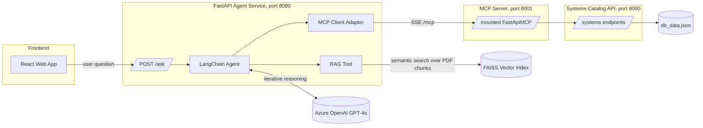

# Enterprise Systems Catalog Agent (RAG + MCP)

A proof-of-concept chat agent that answers domain-specific questions about an enterprise systems catalog by combining retrieval-augmented generation (RAG) over PDF documents with tool use against a FastAPI-exposed systems catalog. The frontend is a React web app; the agent is orchestrated with LangChain and exposed as a REST API via FastAPI.

> **Note:** This is a proof of concept. All documents, catalog data, and API endpoints are synthetic/mocked. The only external dependency that requires real configuration is Azure OpenAI (see `.env.example`).

## Architecture



### How it works

1. A user submits a question through the React web app's chat panel, which calls the agent's `/ask` endpoint.
2. The LangChain agent iteratively collaborates with GPT-4o: the model decides what information it still needs to answer the question.
3. To gather that information, the agent can invoke either tool:
   - **`domain_knowledge_retriever`** (RAG): retrieves semantically relevant chunks from the FAISS index built over the PDF documents.
   - **MCP tools**: calls read-only operations (`get_system_by_id`, `get_all_systems`) exposed on the Systems Catalog API through an MCP server, over the Model Context Protocol.
4. Retrieved chunks and tool results are added to the model's context, and the agent loops until it has enough information to produce an answer.

### RAG pipeline (ingestion)

- PDFs are loaded with `PyPDFLoader`
- Text is split with `RecursiveCharacterTextSplitter` (`chunk_size=1000`, `chunk_overlap=200`)
- Chunks are embedded with `AzureOpenAIEmbeddings` (text-embedding-ada-002) and stored in an in-memory FAISS index built at startup
- At query time, the retriever performs semantic search over the index

### MCP tool access

The Systems Catalog API (`main.py`) is a standard FastAPI app exposing `POST /systems/`, `GET /systems/{id}`, and `GET /systems/`. A separate `FastApiMCP` instance mounts it at `mcp_app`, exposing only the read operations (`get_system_by_id`, `get_all_systems`) over MCP so the LangChain agent can call them as tools through `MultiServerMCPClient` using SSE transport.

## Tech Stack

| Layer | Technology |
|---|---|
| LLM | Azure OpenAI (GPT-4o) |
| Embeddings | Azure OpenAI (text-embedding-ada-002) |
| Agent orchestration | LangChain |
| Document loading / chunking | PyPDFLoader, RecursiveCharacterTextSplitter |
| Vector database | FAISS (in-memory) |
| Tool protocol | MCP via fastapi-mcp + langchain-mcp-adapters |
| Backend APIs | FastAPI, Pydantic |
| Frontend | React (Create React App) + Tailwind CSS |
| AI-assisted development | VS Code + GitHub Copilot |

## Repository Layout

```text
.
├── backend/
│   ├── agent_RAG_MCP.py       # FastAPI agent service + LangChain RAG/MCP tools
│   ├── main.py                # Systems Catalog API + MCP server (mcp_app)
│   ├── db_data.json           # Synthetic seed catalog data
│   ├── sample_docs.pdf        # Synthetic knowledge base for RAG
│   ├── requirements.txt
│   ├── .env.example
│   └── eval/                  # Saved sample questions and answers
├── frontend/                  # React web app (Systems Catalog UI + chat)
├── docs/                      # Copies of eval examples
└── README.md
```

## Getting Started

### Prerequisites

- Python 3.8+
- Node.js 18+
- An Azure OpenAI resource with a `gpt-4o` and a `text-embedding-ada-002` deployment

### Backend

```bash
cd backend
python -m venv venv
source venv/bin/activate        # Windows: venv\Scripts\activate
pip install -r requirements.txt

# Configure environment
cp .env.example .env            # fill in your Azure OpenAI key and endpoint
```

Start the three services in separate terminals (all from `backend/`):

```bash
# 1. Systems Catalog REST API  (port 8000)
uvicorn main:app --host 127.0.0.1 --port 8000

# 2. MCP server for the catalog  (port 8001)
uvicorn main:mcp_app --host 127.0.0.1 --port 8001

# 3. The chat agent  (port 8080)
uvicorn agent_RAG_MCP:app --host 127.0.0.1 --port 8080
```

Note: the agent builds the FAISS index and configures its LLM client at import time, so it needs a valid `backend/.env` before it will start.

### Frontend

```bash
cd frontend
npm install
npm start
```

Open the app, then use the "Need Assistance?" chat panel to ask questions. The catalog list, system detail view, and add-system form use the REST API on port 8000; the chat panel calls the agent on port 8080.

## Example questions

Saved under `backend/eval/` and `docs/`:

- "What are the steps to follow for a planned system outage?" (RAG over the PDF)
- "Who is my business contact for the HR System?" (MCP tool call to the catalog)
- "Can you get me the names and emails of the contacts for HR System in a tabular format?" (MCP tool call, formatted output)
- "How many systems do we have in enterprise catalog?" (MCP tool call)
- "What is the 401k match and when does it vest?" (example of a question the knowledge base does not cover — agent declines to fabricate)

## Design Decisions

- **FAISS in-memory**: chosen for the PoC because it requires zero infrastructure and starts up fast. Tradeoff: the index is rebuilt on every startup and is not persistent. The natural next step for anything beyond a PoC is a persistent vector database (pgvector, Qdrant, or Azure AI Search).
- **RAG as a tool, not a chain**: instead of a fixed `RAG chain` that always injects retrieved chunks, retrieval is exposed as a tool the agent can choose to invoke. This lets the model decide whether a question is best answered from documents, from the catalog API, or both.
- **MCP for tool access**: the catalog API is mounted as an MCP server so the agent calls it through the standard Model Context Protocol rather than bespoke HTTP calls, decoupling the agent from API-specific details and making the tool surface explicit (only read operations are exposed).
- **Async invocation**: `agent_executor.ainvoke` is used rather than the synchronous `invoke`, because the MCP tool with SSE transport does not work under a synchronous call path.

## Limitations & Future Work

- FAISS index is rebuilt on every startup; not persistent
- `db_data.json` is a file-backed mock — a real deployment would use a database
- No conversation memory: each `/ask` call is independent; the web app maintains chat history client-side only
- CORS is `allow_origins=["*"]` for the PoC; should be restricted to the frontend origin in any real deployment
- No evaluation harness or automated tests yet; `backend/eval/` holds illustrative saved responses, not a measured benchmark

## License

<!-- TODO: choose a license (MIT is common for portfolio projects) and add the LICENSE file. -->
